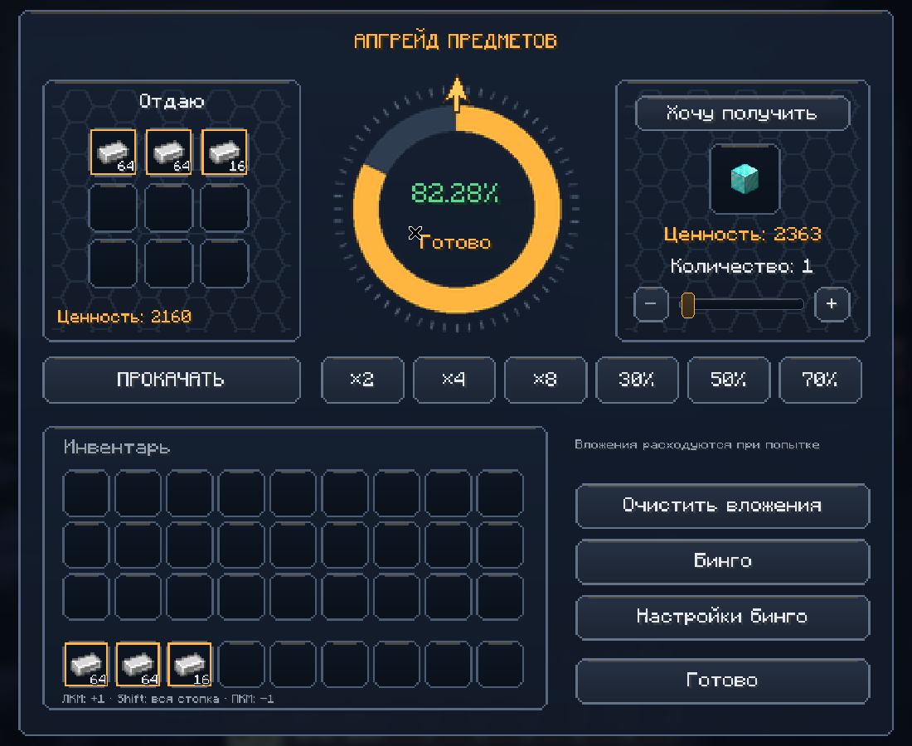
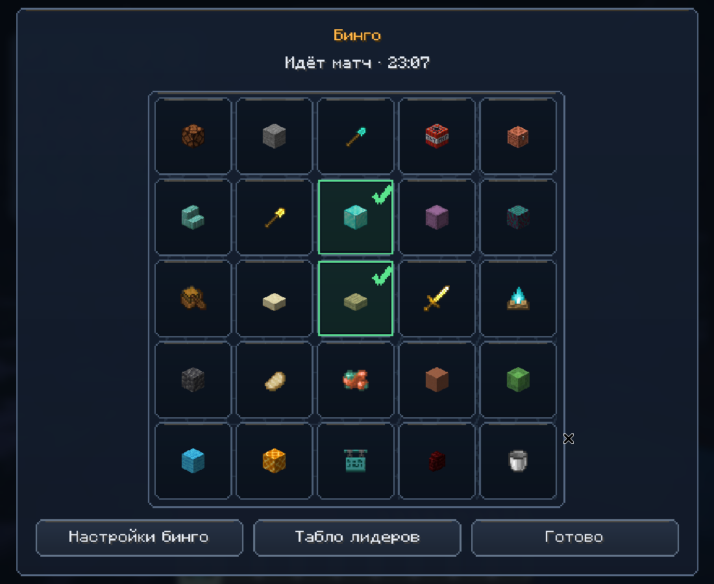
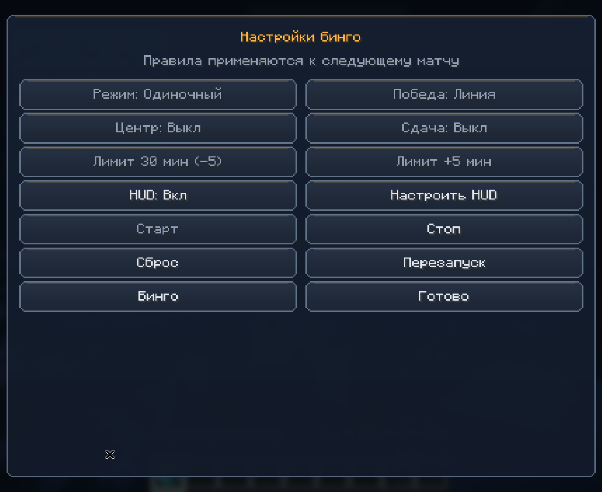
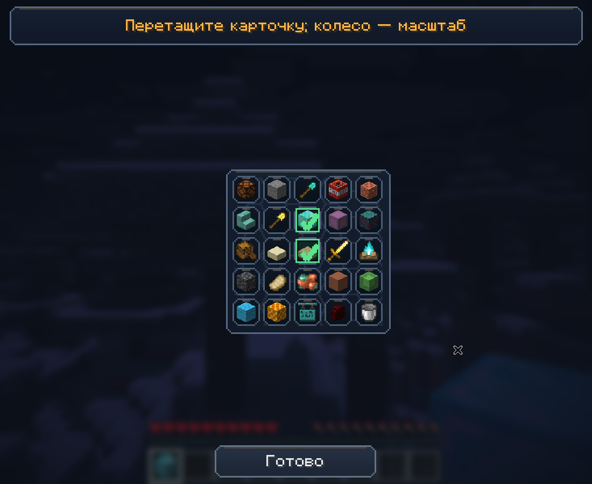

# Bingo Upgrader 1.0.2

Полный Fabric-мод для **Minecraft Java Edition 26.2**: бинго 5×5,
серверный апгрейдер предметов, динамическая система ценностей и единый
анимированный интерфейс с русской и английской локализацией.



## Демонстрация бинго

### Игровая карточка 5×5



### Настройки бинго



### HUD в игровом мире



## Скачать мод

Актуальная версия: **1.0.2**. Файл `releases/bingo-upgrader.jar` — основной готовый мод; версионные файлы сохранены для истории.

[Скачать актуальный мод — bingo-upgrader.jar](https://github.com/koariy/bingo-upgrader/raw/refs/heads/main/releases/bingo-upgrader.jar)

Нужны Minecraft 26.2, Java 25, Fabric Loader и Fabric API. JAR положить в папку `mods`, не распаковывая.

## Изменения 1.0.2

Стандартная клавиша скрытия/показа HUD-таблицы изменена с B на **Tab**.
Если уже использовалась предыдущая версия, выберите Tab вручную в назначении клавиш:
Minecraft сохраняет существующие бинды. Tab также назначен vanilla-списку игроков;
при необходимости переназначьте список игроков в управлении.

## Изменения 1.0.1

- Добавлены четыре сложности бинго: **лёгкая, обычная, сложная, эксперт**. Чем выше сложность, тем больше дорогих и редких предметов.
- На лёгкой сложности исключены поздние предметы Незера/Энда, даже если их ценность низкая.
- Добавлена переназначаемая клавиша **B** для скрытия и показа HUD-таблицы.
- Добавлена плавная анимация сворачивания/разворачивания; повторное нажатие меняет направление без скачка.
- Из настроек бинго можно открыть назначение клавиш. Настройка видимости сохраняется.
- Старые карточки и пользовательские конфиги сохранены; выбранная сложность применяется к новому матчу.

Полный список и инструкция обновления: [CHANGELOG.md](CHANGELOG.md).

## Установка и сборка

| Компонент | Закреплённая версия |
| --- | --- |
| Minecraft | 26.2 |
| Java / Gradle JVM | JDK 25 |
| Fabric Loader | 0.20.1 или совместимый новее |
| Fabric API | 0.161.0+26.2 |
| Fabric Loom | 1.17.21 |
| Gradle Wrapper | 9.5.1 |

Установить JDK 25 и выбрать его для JAVA_HOME и Gradle JVM IDE. Интернет нужен
при первой загрузке Gradle, Minecraft, библиотек и игровых ресурсов.

```sh
./gradlew build
./gradlew runClient
./gradlew runServer
```

Windows: `gradlew.bat build`. Готовый мод — `build/libs/bingo-upgrader-1.0.2.jar`.
`-sources.jar` содержит исходники, устанавливать его в mods не нужно.
Скопировать обычный JAR и Fabric API в `mods` клиента и сервера с Fabric Loader.
Для dedicated server самостоятельно прочитать и принять Minecraft EULA.
Клиент и сервер должны использовать **одинаковую версию 1.0.2**: протокол
превью расширен относительно промежуточных частей 1–4.

Дополнительных игровых зависимостей нет. Gson/SLF4J берутся из Minecraft/Loader.
Все готовые PNG включены; Pillow нужен только для необязательной перегенерации
ресурсов через `tools/generate_ui_assets.py`, а не для сборки или игры.

## Апгрейдер

Открыть клавишей **U** (переназначается в настройках управления), командой
`/upgrader` или ПКМ по блоку `bingo_upgrader:upgrader`. Работает в Survival/Adventure
при закрытом чужом контейнерном меню. Блок крафтится:

```text
I R I
R C R
I I I
```

I — железный слиток, R — редстоун, C — верстак. Добыча каменной киркой или лучше.

- При открытии выбрана стопка в основной руке. В инвентаре **ЛКМ** добавляет
  одну штуку, **Shift+ЛКМ** — всю стопку, **ПКМ** убирает одну,
  **Shift+ПКМ** очищает слот. Клик по слоту «Отдаю» убирает его из вложений.
  Если выбрано больше девяти стопок, колесо мыши над панелью листает их.
- «Хочу получить» открывает каталог: поиск по локализованному имени/ID,
  категории, тиры, фильтр доступности по ценности и сортировка. Полный ID с
  namespace выбирается как точное совпадение. Список прокручивается колесом.
- Количество цели меняется слайдером и −/+. Выход — одна обычная стопка одного
  типа, не более maxStackSize. Входов может быть несколько.
- ×2/×4/×8 и 30%/50%/70% запрашивают ближайшую допустимую цель **на сервере**.
  Из-за дискретных цен/количеств фактический шанс может отличаться от пресета.
- «ПРОКАЧАТЬ» активна только для актуального ответа сервера. Вложения тратятся
  при любом исходе. Если возможный приз не помещается, попытка отклоняется до списания.
- Исход и координата остановки приходят до анимации. После неё интерфейс
  показывает успех/неудачу, вспышку, частицы, звук и тост. Закрытие окна
  не отменяет уже совершённую попытку и не задерживает выдачу.

Виртуальные слоты выбора **не перемещают** вещи на клиенте и не держат escrow.
Сервер повторно проверяет реальные ItemStack, точные количества/компоненты,
версию ценностей, одноразовый token, права доступа к операции и лимиты.
Превью обновляется с debounce и автоматически освежается до истечения серверного
срока. requestId защищает интерфейс от запоздалых ответов на старое положение слайдера.

Текстовые команды оставлены для проверки/администрирования:

```text
/upgrader values minecraft:diamond
/upgrader reload
/upgrader dump
/upgrader clear
/upgrader offer 0 16
/upgrader preview minecraft:diamond 1
/upgrader quick p50
/upgrader roll
```

reload/dump требуют OP 2. Подробности сервера: [docs/UPGRADER.md](docs/UPGRADER.md).

## Бинго

Новое в 1.0.1: выбор **easy / normal / hard / expert** в настройках матча;
клавиша **Tab** скрывает и показывает HUD-карточку с плавной анимацией. Бинд
переназначается в управлении, из настроек бинго можно открыть назначение клавиш.


```text
/bingo settings
/bingo start
/bingo card
/bingo scoreboard
/bingo stop
/bingo restart
/bingo reset
```

Три режима: solo (запускающий игрок), coop (общий прогресс), competitive
(одна карточка, личный прогресс, первый серверно обнаруженный победитель).
Участники — online Survival/Adventure при старте. Поздние подключения наблюдают
до следующего матча, переподключение участника сохраняет прогресс по UUID.
Цель: одна линия, две линии или вся карточка; бесплатный центр опционален.

Клетки автоматически отмечаются по инвентарю, включая предметы апгрейдера.
В режиме surrender сервер забирает одну штуку за новую клетку. Содержимое
контейнерного предмета при такой сдаче также расходуется. Уже имевшиеся предметы
засчитываются после старта; вещи на курсоре/в сундуке не считаются инвентарём.
Проверки идут после подбора/крафта/апгрейда и каждый серверный тик.

Карточка, настройки, табло и HUD используют ту же тему, кнопки, рамки,
подсказки и тосты, что апгрейдер. Новая клетка подсвечивается зелёным, галочка
появляется с небольшим отскоком; готовые линии пульсируют золотым.
Settings → «Настроить HUD»: перетаскивание левой кнопкой, колесо меняет масштаб.
Положение/масштаб сохраняются локально; HUD можно выключить, F1 его скрывает.

Управление матчем — OP 2 или UUID из managers; карточка и табло доступны всем.
Таймер считает серверные тики, не расходует время при выключенном сервере.
Карточка, участники, отметки, победитель и время сохраняются в мировом SavedData.
Подробнее: [docs/BINGO.md](docs/BINGO.md).

## Конфиги и баланс

Готовые полные примеры: [examples/config/bingoupgrader](examples/config/bingoupgrader).
Файлы создаются автоматически в `config/bingoupgrader/`:

| Файл | Назначение |
| --- | --- |
| values.json | Базовые цены, рецепты/теги, overrides, blacklist, компоненты |
| upgrader.json | houseEdge, шансы, лимиты, pity, blacklist |
| bingo.json | Режим, цель, тиры/распределение, сдача, время, managers |
| client.json | showItemValues для обычных tooltip |
| bingo-client.json | HUD on/off, относительные координаты и масштаб |

Отсутствующие поля получают defaults. Явно заданные списки/карты заменяют поле
целиком. Для точечных цен использовать overrides. `/upgrader reload` перечитывает
ценности и апгрейдер; `/bingo settings reload` — настройки будущих матчей бинго.
Неверный reload оставляет рабочие данные. При первом запуске с ошибочным JSON
логируется ошибка и используются defaults; исходный файл не перезаписывается.

Базовый баланс: палка 1, булыжник 0.5, брёвна 2, железо 15, золото 25,
редстоун 5, алмаз 250, незерит 1500, элитра 5000, тотем 3000, звезда Незера 8000.
Яйцо дракона запрещено. Крафт: сумма дешёвых допустимых ингредиентов / countResult
× markup (1.05 по умолчанию). Циклы без опоры и неизвестные классы машин
модов переходят в unknown (default 1). unknown не используется как доказанная
цена ингредиентов, и по умолчанию не может быть призом апгрейдера. `allowUnknownTargets=true`
разрешает ручные unknown-цели; quick-подбор всё равно их исключает.

```text
raw = valueIn / valueOut × (1 - houseEdge)
raw < minChance → отказ, без округления вверх
chance = min(raw, maxChance)
```

Defaults: edge 10%, minChance 0.0005 (=0.05%), maxChance 0.9, 30 попыток в
rolling-minute, maxTargetValue 100000, pity off. Одна палка → алмаз: **0.36%**;
64 палки → алмаз: **23.04%**. Без pity/cap ожидание равно **0.9 × вложение**.
Верхний cap только уменьшает его. Pity ограничена половиной маржи и даже
после серии не создаёт положительного математического ожидания.

Как тюнить:

1. Выполнить `/upgrader dump`, просмотреть source=unknown и закрепить важные
   ресурсы/модовые предметы в overrides, исключить запрещённые/неполучаемые вещи.
2. По умолчанию `allowUnknownTargets=false`: неизвестные редкие предметы не
   генерируются за цену 1. Сначала закрепить их цену overrides, затем разрешать цели.
   Настроить стоимость ресурсов прежде, чем менять houseEdge. Прочность
   уменьшает цену, зачарования и эффекты зелий добавляют её; формулы — в документации сервера.
3. Увеличивать houseEdge для более жёсткой экономики; снижать maxTargetValue и
   attemptsPerMinute для редких призов. Не поднимать слишком высоко unknownValue.
4. Для бинго менять границы/count четырёх тиров. Сумма 25 без free center или
   24 с ним; нехватка уникальных целей отклоняет старт, а не подменяет тиры.
5. После изменения модпака проверить dump и `./gradlew valueChecks` заново:
   чужие рецепты/дроп/доступность ресурсов нельзя сбалансировать одной общей формулой.

## Клиентская архитектура и ресурсы

- `client/ui`: Ui, ThemeButton, ThemeSlider, ThemeToast, CanvasScreen,
  UiSound, UpgradeAnimation, ChanceWheel, BingoVisuals.
- `client/screen`: UpgraderScreen, TargetPickerScreen.
- `client/bingo`: BingoBoard, BingoCardScreen, BingoSettingsScreen, BingoHudEditor,
  BingoClientConfig.
- `client/network`: ClientValues, ClientUpgrader, ClientBingo.
- `common`: модели, кодеки, VisualMath/CanvasLayout, никакого клиентского RNG для исхода.
- `server`: все списания/выдачи, шансы, матч, конфиги, команды и авторизация.

[docs/CLIENT.md](docs/CLIENT.md) описывает input/animation/protocol,
[docs/RESOURCES.md](docs/RESOURCES.md) — каждый PNG/звук/шрифт, размеры и замену.
Minecraft default font используется с кириллицей, сторонние шрифты не нужны.
Локали: `assets/bingo_upgrader/lang/{ru_ru,en_us}.json`.

Рендер использует GuiGraphicsExtractor/Blaze3D 26.2, без raw OpenGL. Логический
canvas и обратное преобразование pointer событий масштабируются под GUI Scale.
Анимации идут по System.nanoTime с интерполяцией на кадрах, а не числом тиков.
Текстуры/иконки кэшируются, сортировка каталога выполняется при изменении
поиска/фильтров/таблицы. Кольцо — готовый атлас, частицы ограничены 28 на эффект.

## Проверки и документация API

`build` включает `valueChecks`, без внешнего тестового framework. Проверяются
модели/конфиги, граф рецептов, реальные компоненты Minecraft, транзакции инвентаря,
правила/сдача/сохранение бинго, пакеты, анимационная математика и масштабирование.
Симуляция: 12 млн попыток для шести пар, фиксированный seed, допуск 6 стандартных
ошибок среднего; отчёт `build/value-checks/balance.csv`.
`valueChecks` также экспортирует defaults в `build/value-checks/examples/`.

Итог: 14029 автоматических проверок + 12 млн симуляций; интерфейс и интеграция
апгрейдер → бинго проверены в настоящем одиночном мире, включая сохранение/перезапуск.
Снимки и границы проверки: [docs/VERIFICATION.md](docs/VERIFICATION.md).

Актуальные источники:

- https://fabricmc.net/2026/06/15/262.html
- https://fabricmc.net/2026/03/14/261.html
- https://docs.fabricmc.net/develop/networking
- https://docs.fabricmc.net/develop/rendering/gui/custom-screens
- https://docs.fabricmc.net/develop/rendering/hud

Использованы необфусцированный `net.fabricmc.fabric-loom`, обычный implementation
и jar, без Yarn/remapJar; `Minecraft.gui.setScreen`, `GuiGraphicsExtractor`,
MouseButtonEvent/InputWithModifiers, HudElementRegistry, typed payload codecs,
SavedDataType/Codec и Minecraft data components. Точные сигнатуры сверены по
закреплённым JAR. История серверных решений сохранена в docs/UPGRADER.md и BINGO.md;
этот README и CLIENT.md описывают финальный клиент 1.0.1.
